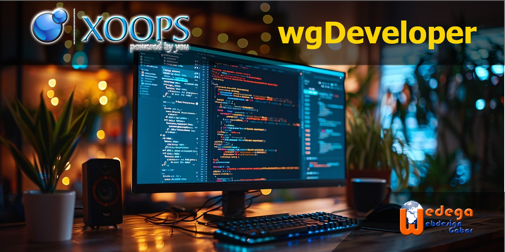

# wgDeveloper

**wgDeveloper** is an administration and development utility module for [XOOPS](https://xoops.org/). It brings a set of tools for inspecting and maintaining a XOOPS installation into the administration area.

The module is intended for site administrators and developers. It does not provide a public-facing module page.

## Features

### Database tools

The administration interface includes a database browser and SQL tools:

- List database tables.
- Inspect table columns and their metadata (type, nullability, key, default and extra attributes).
- Browse table records and view record details.
- Edit or delete individual records.
- Open an SQL editor, inspect the available columns for a table, and execute SQL statements.
- Truncate or drop tables.

> **Warning:** Database changes can cause data loss or leave modules in an inconsistent state. Deleting records directly, truncating tables, dropping tables, or executing SQL should only be done by an administrator who understands the consequences. Make a verified database backup before performing maintenance.

### Language-file checker

The language checker scans a selected module's English language definitions and checks whether each definition is referenced elsewhere in that module. It can display all results or show warnings only, helping developers identify unused or missing language constants.

### Administration

The module also provides:

- An administration dashboard.
- Configurable administration list pagination (10, 25, 50 or 100 items per page).
- A setting to show or hide dashboard feedback.
- Module metadata settings for description and keywords.

## Requirements

The module metadata declares the following minimum versions:

| Component | Minimum version |
| --- | --- |
| PHP | 8.4 |
| XOOPS | 2.7.3 |
| ModuleAdmin | 1.2 |
| MySQL / MySQLi | 5.6 |

Use a supported XOOPS installation and ensure that the PHP extensions and database driver required by your XOOPS installation are enabled.

## Installation

1. Download or clone this repository.
2. Ensure the module directory is named `wgdeveloper`.
3. Copy the `wgdeveloper` directory into the `modules` directory of your XOOPS installation.
4. Sign in to XOOPS as an administrator.
5. Open **Administration → Modules** (module management).
6. Find **wgDeveloper** in the uninstalled modules and install it.
7. Open the module's administration area.

If you are upgrading an existing installation, back up the database and module files first, then follow the normal XOOPS module update procedure.

## Usage notes

- The database browser exposes low-level database operations. Prefer the relevant module's own administration functions for routine content management.
- The language checker uses the module's `language/english` definitions as its source when checking language-constant usage.
- The module is an administrator tool; access should be limited to trusted users with appropriate XOOPS administration permissions.

## Development

The source is maintained in this repository:

- [GitHub repository](https://github.com/XoopsModules27x/wgdeveloper)
- [XOOPS project](https://xoops.org/)
- [Wedega Webdesign](https://xoops.wedega.com)

Contributions, bug reports and suggestions are welcome through the repository's issue and pull-request facilities.

## Support

For XOOPS-related support, visit the [XOOPS support forum](https://xoops.org/modules/newbb).

## License

The module metadata identifies the license as **GPL 2.0 or later**. See the source files for the applicable copyright and license notices.
